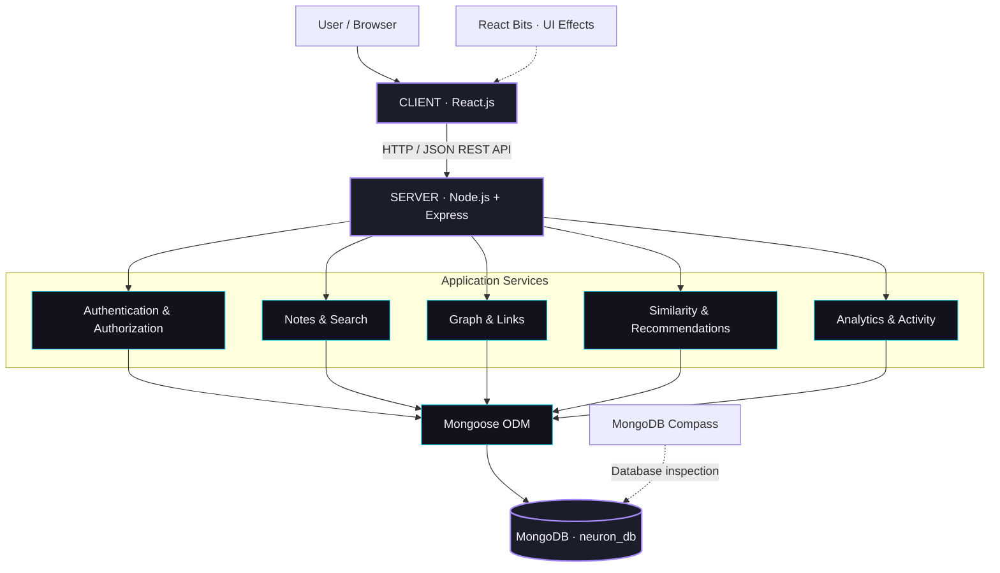
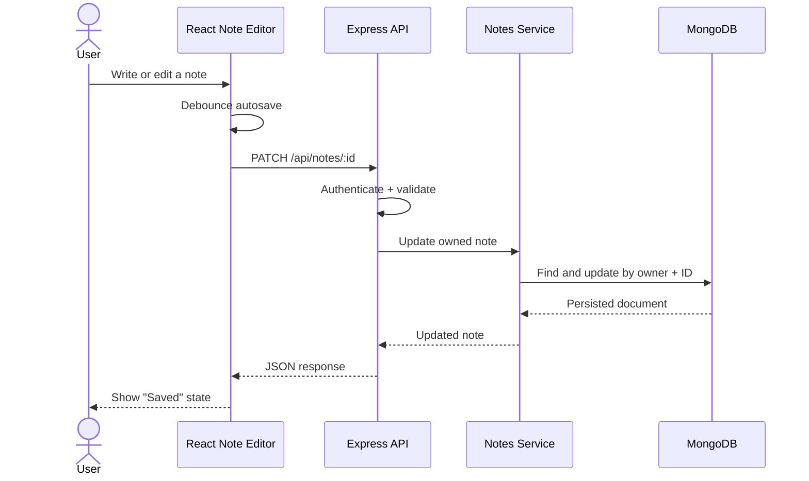

<div align="center">

# 🧠 NEURON

### Your Mind, Connected.

**A visual second brain that transforms isolated notes into an interconnected universe of knowledge.**

Explore ideas. Discover relationships. Follow the connections.

<br />


<br />


**[Overview](#-overview)** · **[Features](#-core-features)** · **[Architecture](#-system-architecture)** · **[Algorithms](#-intelligence--algorithms)** · **[Setup](#-getting-started)** · **[API](#-api-reference)** · **[Demo](#-demonstration-walkthrough)**

</div>

---

> **Project status:** This document describes NEURON's designed architecture and implementation targets. As development proceeds, verify each feature against the working code and replace the *In Development* badge with the appropriate status. Screenshots, benchmarks, and test results should be included only after they have been captured or measured.

## ✨ Overview

Information rarely exists in isolation. A concept learned in class may be connected to an article, a project, a code snippet, or an idea recorded weeks earlier. Traditional note-taking systems make it easy to **store** information—but not always to **understand how information connects**.

**NEURON** is a full-stack personal knowledge management application built to solve that problem. Instead of treating notes as disconnected documents, NEURON represents knowledge as an **interactive graph**:

- **Notes are nodes**—individual ideas, documents, or concepts.
- **Relationships are edges**—meaningful connections between notes.
- **Clusters emerge naturally**—related knowledge becomes easier to explore.
- **Recommendations reveal possibilities**—a transparent similarity engine suggests links a user may have missed.

The result is a workspace that supports both **structured note-taking** and **visual, connected thinking**.

### The problem we are solving

| Common challenge | NEURON's approach |
| --- | --- |
| Ideas get buried in folders and long lists. | An interactive knowledge graph provides a spatial overview. |
| Related notes remain disconnected. | Manual backlinks and algorithmic connection suggestions. |
| Searching by file name alone is limiting. | Full-text search across titles, content, and tags. |
| It is difficult to trace how concepts relate. | Shortest-path discovery across saved relationships. |
| Knowledge growth is hard to observe. | A dashboard with real database-driven metrics. |
| Attractive demos often lack real persistence. | A React client, Node.js API, and MongoDB-backed data model. |

### Project objectives

1. Design a responsive, distinctive interface using **React and React Bits**.
2. Implement a modular **Node.js/Express REST API** with secure user authentication.
3. Persist and retrieve application data using **MongoDB**, with inspection through **MongoDB Compass**.
4. Model user knowledge as a graph and implement practical **graph algorithms**.
5. Recommend related notes using **explainable text-similarity techniques**, without depending on an external AI API.
6. Demonstrate genuine **frontend–backend–database integration** through repeatable user workflows.

---

## 🚀 Core Features

| Module | Functionality | Technical significance |
| --- | --- | --- |
| **Knowledge Graph** | Explore notes as draggable, connected nodes; zoom, pan, filter, and inspect relationships. | SVG visualization, `d3-force`, interaction state, persisted layouts. |
| **Notes Workspace** | Create, edit, pin, archive, tag, and delete Markdown notes. | End-to-end CRUD, input validation, autosave, document storage. |
| **Connection Management** | Create and remove typed relationships between notes. | Graph-edge modeling, referential integrity, owner validation. |
| **Smart Discovery** | Suggest related notes with explainable similarity scores. | Jaccard similarity, TF-IDF, cosine similarity, ranking. |
| **Knowledge Path Finder** | Find the shortest saved path between two ideas. | Breadth-first search over graph relationships. |
| **Command Search** | Search notes and navigate quickly with `Ctrl/Cmd + K`. | MongoDB text search, debounced queries, keyboard interactions. |
| **Analytics** | Explore note counts, links, orphaned nodes, popular tags, and activity. | Aggregation and derived graph statistics. |
| **Account & Settings** | Register, sign in, manage preferences, and export personal data. | Authentication, authorization, secure cookies, user isolation. |
| **Demo Brain** | Populate a sample knowledge network to explore the system. | Idempotent, user-scoped MongoDB seeding. |

### A typical experience

**Capture** a note → **tag** the concept → **see** it appear in your graph → **connect** it to existing knowledge → **discover** related notes → **trace** a path between distant ideas.

This sequence is the central product experience; the graph is not merely a decorative animation.

---

## 🎨 Interface & Visual Identity

NEURON follows a **dark, minimal, futuristic** visual direction inspired by premium creative tools and spatial interfaces. Its goal is to make complex knowledge visually approachable—not to overwhelm users with effects.

| Design token | Value | Purpose |
| --- | --- | --- |
| Background | `#0A0B10` | Deep neutral canvas |
| Surface | `#11121C` | App panels |
| Elevated surface | `#171824` | Cards and editors |
| Primary | `#A78BFA` | Selected nodes and key actions |
| Secondary | `#22D3EE` | Links and supporting accents |
| Tertiary | `#F472B6` | Secondary clusters and highlights |
| Primary text | `#F4F2FF` | Headings and content |
| Muted text | `#A5A0BD` | Supporting information |

### React Bits usage

[React Bits](https://reactbits.dev/) supplies **JavaScript + CSS** animation and interface components for selected moments, while custom React components implement the functional application.

| Component | Intended placement |
| --- | --- |
| `Orb` and `Aurora` | Landing-page visual atmosphere |
| `Decrypted Text` | Brand and hero text animation |
| `Magic Bento` | Dashboard highlights |
| `Glass Surface` | Floating panels and toolbars |
| `Dock` | Graph workspace controls |
| `Spotlight Card` | Note and discovery cards |
| `Animated List` | Activity feed and recommendations |
| `Count Up` | Knowledge statistics |
| `Click Spark` | Lightweight action feedback |

**Design constraint:** Effects are used selectively, respect reduced-motion preferences, and never replace functional graph controls or readable content.

### Planned screens

`Landing` · `Register / Login` · `Dashboard` · `Graph Workspace` · `Notes Library` · `Markdown Editor` · `Discover` · `Settings`

<!-- After building the project, consider adding verified screenshots here:
     docs/screenshots/dashboard.png
     docs/screenshots/knowledge-graph.png
     docs/screenshots/note-editor.png
     Do not add image links until the files exist. -->

---

## 🏗️ System Architecture

NEURON uses a conventional **three-tier full-stack architecture**. Each layer has a clearly defined responsibility.



### Architectural responsibilities

| Layer | Responsibility |
| --- | --- |
| **Client (`client/`)** | React pages, form state, user interactions, graph rendering, API requests, animations. |
| **API (`server/`)** | Request routing, input validation, authentication, authorization, errors, JSON responses. |
| **Domain services** | Note lifecycle, relationship rules, search, analytics, graph construction. |
| **Algorithms** | Similarity scoring and breadth-first search; independently testable logic. |
| **Persistence** | MongoDB collections managed through Mongoose models and indexes. |
| **Inspection** | MongoDB Compass verifies that notes and relationships are truly stored. |

### Example: saving a note end to end



**Persistence check:** Reloading the browser should request the note again from the backend and return the same saved data. The browser is not the source of truth.

---

## 🧰 Technology Stack

| Category | Technology | Why it is used |
| --- | --- | --- |
| Frontend | **React.js** | Component-based interactive UI. |
| Language | **JavaScript (ES6+)** | Shared language across the client and server. |
| Styling | **HTML5 + CSS3** | Semantic pages, custom layout, responsive visual system. |
| Motion/UI | **React Bits** | Carefully selected interactive visual effects. |
| Build tooling | **Vite** | Local React development and production builds. |
| Server | **Node.js + Express.js** | REST endpoints and application logic. |
| Database | **MongoDB** | Flexible document storage for knowledge records. |
| ODM | **Mongoose** | Models, validation, queries, indexes. |
| Database GUI | **MongoDB Compass** | Local inspection and database queries. |
| Graph layout | **d3-force** | Node positioning and physics simulation. |
| Graph interactions | **SVG + React (+ d3-zoom)** | Custom, inspectable graph controls. |
| Markdown | **react-markdown** | Rendering saved note content. |
| Routing | **React Router** | Navigation between application screens. |

**Strict stack boundary:** No TypeScript, Next.js, Tailwind CSS, Python backend, Firebase, Supabase, SQL database, external AI API, or separate vector database is required.

---

## 🧠 Intelligence & Algorithms

NEURON's most distinctive features are driven by understandable data structures and algorithms rather than opaque services.

### 1. Knowledge graph representation

Each note is a **vertex** and each saved relationship is an **edge**:

\[
G = (V,E)
\]

An example graph could contain the path:

```text
Machine Learning
      │
      ▼
Neural Networks ──────► Deep Learning
      │
      ▼
Transformers
      │
      ▼
Large Language Models
```

The graph UI is powered by persisted MongoDB documents—not generated solely on the client. A force-directed layout uses repulsive and attractive forces to position connected nodes. User-pinned coordinates and viewport settings are stored separately to survive reloads.

### 2. Shortest knowledge path — Breadth-First Search

Given two selected notes, NEURON searches the saved graph for the **shortest path in number of connections** using BFS.

- **Input:** source note ID and destination note ID.
- **Processing:** traverse adjacent notes using a queue and a visited set.
- **Output:** ordered path of note IDs, or no path when disconnected.
- **Time complexity:** **O(V + E)** for the traversed graph.
- **Edge behavior:** relationships may be treated as bidirectional for navigation, while retaining their semantic type in storage.

This supports the question: **“How is concept A connected to concept B through what I already know?”**

### 3. Explainable note recommendations

The suggestion engine compares notes using three signals:

1. **Tag overlap:** Jaccard similarity between normalized tag sets.
2. **Text overlap:** TF-IDF vectors and cosine similarity of note content.
3. **Title overlap:** Jaccard similarity of title keywords.

The weighted score is:

\[
\boxed{S(A,B)=0.45J_{tags}+0.35C_{TF-IDF}+0.20J_{title}}
\]

Candidate notes are ranked by the score. Existing connections, the source note itself, and archived notes (by default) are filtered out. Suggestions also explain *why* notes appear related—for example, shared tags or important keywords.

> **Important distinction:** This is a deterministic, explainable **content-similarity system**, not an LLM, semantic embedding service, or claim of human-level understanding.

### 4. Search and knowledge analytics

- **Search:** MongoDB text indexes support title/content/tag queries while maintaining user ownership filtering.
- **Analytics:** Aggregations and graph calculations derive total notes, connections, connected nodes, orphaned nodes, prominent tags, and recent changes.
- **Scalability boundary:** The interactive view is designed around an initial visible graph limit (for example, 250 nodes) with filtering and focus tools for larger collections. This is a UI strategy, not a claimed performance benchmark.

---

## 🗄️ Database Design

**Database:** `neuron_db`

MongoDB is the primary persistent store. Compass is a graphical tool for viewing and inspecting that database; **Compass itself is not the database server**.

| Collection | Core fields | Responsibility |
| --- | --- | --- |
| `users` | `name`, `email`, `passwordHash`, `settings`, timestamps | Identity and personal preferences. |
| `notes` | `owner`, `title`, `content`, `tags`, `color`, `isPinned`, `isArchived`, timestamps | Knowledge content. |
| `links` | `owner`, `sourceNote`, `targetNote`, `relationType`, `label`, timestamps | Typed edges between notes. |
| `graphlayouts` | `owner`, `positions`, `viewport`, `updatedAt` | Per-user node coordinates and view settings. |
| `activities` | `owner`, `action`, `entityType`, `entityId`, `createdAt` | Recent actions and event history. |

### Example note document

```json
{
  "_id": "<MongoDB ObjectId>",
  "owner": "<User ObjectId>",
  "title": "Neural Networks",
  "content": "Neural networks are composed of interconnected layers...",
  "tags": ["AI", "Deep Learning"],
  "color": "#A78BFA",
  "isPinned": false,
  "isArchived": false,
  "createdAt": "2026-10-25T00:00:00.000Z",
  "updatedAt": "2026-10-25T00:00:00.000Z"
}
```

*ObjectId values are shown symbolically. Actual MongoDB documents store them as BSON ObjectIds.*

### Data integrity and indexing

- Each user-owned record is scoped by its `owner` field.
- A link can only connect two notes belonging to the same authenticated user.
- Self-links and duplicate links are rejected.
- Deleting a note also removes links referencing it and its saved graph position.
- Useful indexes include owner/updated date, owner/tags, link endpoints, and user-scoped text search.
- Passwords are stored as salted hashes, never plaintext.

---

## 📁 Project Structure

The root uses **`client/` and `server/`**, as required by the project specification.

```text
NEURON/
│
├── client/                     # React application
│   ├── public/
│   ├── src/
│   │   ├── assets/
│   │   ├── components/
│   │   │   ├── reactbits/       # React Bits JS + CSS components
│   │   │   ├── layout/          # Navigation / application shell
│   │   │   ├── graph/           # Graph renderer, controls, inspector
│   │   │   ├── notes/           # Note cards and editor
│   │   │   └── common/          # Reusable controls and states
│   │   ├── pages/              # Landing, Dashboard, Notes, etc.
│   │   ├── hooks/
│   │   ├── context/
│   │   ├── services/           # API client and request helpers
│   │   ├── utils/
│   │   ├── styles/             # Tokens and component styles
│   │   ├── App.jsx
│   │   └── main.jsx
│   ├── index.html
│   ├── vite.config.js
│   └── package.json
│
├── server/                     # Node.js / Express application
│   ├── src/
│   │   ├── config/             # Database connection
│   │   ├── models/             # Mongoose schemas
│   │   ├── routes/             # REST route definitions
│   │   ├── controllers/        # Request handlers
│   │   ├── services/           # Business rules
│   │   ├── algorithms/         # BFS and similarity scoring
│   │   ├── middleware/         # Auth, validation, errors
│   │   ├── validators/
│   │   ├── utils/
│   │   ├── seeds/              # Optional demo dataset
│   │   └── app.js
│   ├── tests/
│   ├── scripts/                # Setup, combined dev launcher, local MongoDB helper
│   ├── work/                   # Local MongoDB binaries/data/logs (gitignored)
│   ├── server.js
│   └── package.json
│
├── .gitignore
├── package.json                # Root convenience commands
└── README.md
```

**Separation of concerns:** The React client never communicates directly with MongoDB. All reads and writes flow through the server's authorized REST endpoints.

Only **`client/` and `server/`** are top-level project folders. Helper scripts live in `server/scripts/`; local runtime files live in ignored `server/work/`. The hidden `.git` directory is version-control metadata, not a third application folder.

---

## 🔌 API Reference

All endpoints are prefixed with `/api`. Protected operations require authentication.

| Method | Endpoint | Purpose |
| --- | --- | --- |
| `POST` | `/api/auth/register` | Create account. |
| `POST` | `/api/auth/login` | Authenticate user. |
| `POST` | `/api/auth/logout` | End session. |
| `GET` | `/api/auth/me` | Read current account. |
| `PATCH` | `/api/auth/me` | Update account/preferences. |
| `GET` | `/api/notes` | Query notes with sorting/filtering/pagination. |
| `POST` | `/api/notes` | Create note. |
| `GET` | `/api/notes/:id` | Read one note. |
| `PATCH` | `/api/notes/:id` | Update note. |
| `DELETE` | `/api/notes/:id` | Delete note and associated links. |
| `GET` | `/api/search?q=...` | Search a user's knowledge. |
| `GET` | `/api/graph` | Retrieve nodes and edges. |
| `GET` | `/api/graph/layout` | Retrieve saved positions. |
| `PUT` | `/api/graph/layout` | Save graph positions and viewport. |
| `GET` | `/api/graph/path?from=ID&to=ID` | Find shortest connected path. |
| `POST` | `/api/links` | Create relationship. |
| `PATCH` | `/api/links/:id` | Edit relationship. |
| `DELETE` | `/api/links/:id` | Remove relationship. |
| `GET` | `/api/recommendations/:noteId` | Return ranked suggestions. |
| `GET` | `/api/analytics/overview` | Return knowledge analytics. |
| `GET` | `/api/activities` | Read activity timeline. |
| `GET` | `/api/export` | Export user data as JSON. |
| `POST` | `/api/demo/seed` | Insert a sample user-owned graph. |

### Example request and response

```http
POST /api/notes
Content-Type: application/json
Cookie: <authenticated session cookie>

{
  "title": "Graph Traversal",
  "content": "Breadth-first search visits nodes layer by layer.",
  "tags": ["Algorithms", "Graphs"],
  "color": "#22D3EE"
}
```

```json
{
  "success": true,
  "data": {
    "_id": "<created note id>",
    "title": "Graph Traversal",
    "tags": ["Algorithms", "Graphs"]
  }
}
```

*Examples show the intended response contract; the exact returned properties should match the completed API implementation.*

---

## ⚙️ Getting Started

### Prerequisites

Install the following on your machine:

- **Node.js** (22.12+ or 24 LTS for the installed Vite tooling).
- **npm** (included with Node.js).
- **MongoDB Community Server** running locally, or a compatible MongoDB instance.
- **MongoDB Compass** to inspect the database.
- **Git** to clone the repository, if hosted remotely.

### 1. Get the source code

```bash
# If you have a remote Git repository:
git clone <YOUR_REPOSITORY_URL>
cd NEURON

# Otherwise, open a terminal in your existing NEURON project folder.
```

For this local checkout, the root is `D:\flexi`. These convenience commands use the two-folder layout:

```powershell
cd D:\flexi
npm run setup                    # Creates server/.env only if missing
npm --prefix server install
npm --prefix client install
npm run mongo                    # Starts the existing portable MongoDB on Windows
npm run dev                      # Starts both client and server
```

`npm run setup` generates a random JWT secret without printing it or replacing existing credentials. The optional portable MongoDB files are in `server/work/mongodb/`; persistent database files are in `server/work/db/`, with logs in `server/work/mongodb.log`. Keep the data directory to preserve your accounts and notes. On other machines, install MongoDB Community Server and start its service instead. The separate client/server commands below remain supported.

### 2. Configure MongoDB

Make sure MongoDB Community Server is running and listening on its default local port **27017**.

Connect in MongoDB Compass with:

```text
mongodb://127.0.0.1:27017
```

The application database is named `neuron_db`. MongoDB creates the database and collections when data is first written.

### 3. Configure the backend

```bash
cd server
npm install
```

Create `server/.env` from `server/.env.example` and configure:

```dotenv
PORT=5000
MONGODB_URI=mongodb://127.0.0.1:27017/neuron_db
JWT_SECRET=replace_this_with_a_long_random_secret
NODE_ENV=development
CLIENT_ORIGIN=http://localhost:5173
```

**Never commit `.env` or real secrets to version control.**

Start the server:

```bash
npm run dev
```

Expected backend address: **http://localhost:5000**.

### 4. Configure the frontend

Open another terminal from the repository root:

```bash
cd client
npm install
npm run dev
```

Open **http://localhost:5173** in the browser.

The Vite development proxy should forward `/api` requests to `http://localhost:5000`.

> **Verified commands:** From the root, `npm test`, `npm run test:integration`, and `npm run build` run the unit tests, real-MongoDB integration tests, and production frontend build. Integration tests use a separate `neuron_test` database and remove only their generated test accounts and records.

### 5. Verify actual persistence

1. Register a user from the React interface.
2. Create a note titled **“First Neuron”**.
3. Refresh the Notes Library and ensure the note reappears.
4. Open Compass → `neuron_db` → `notes`.
5. Find the newly created document and confirm its saved title, content, and owner.
6. Create a second note, connect them in the graph, and inspect the `links` collection.

This is the simplest way to verify that the **React frontend, Express backend, and MongoDB database** are connected end to end.

---

## 🔒 Security & Reliability

Security is a deliberate part of the application design—not an optional final enhancement.

- **Password safety:** bcrypt-based salted password hashes.
- **Session security:** signed JWT sessions stored in `HttpOnly` cookies, with production-only `Secure` behavior over HTTPS.
- **Authorization:** all protected notes, relationships, and graph layouts are filtered by authenticated owner.
- **Validation:** reject invalid IDs, unsupported relationship types, malformed payloads, and self-links.
- **API protection:** security headers, authentication rate limits, and origin/CSRF protection for state-changing requests.
- **Data integrity:** link operations verify both endpoint notes belong to the same user.
- **Editor resilience:** debounced autosave, visible save state, and failure handling.
- **Accessibility:** semantic controls, keyboard navigation, adequate contrast, and reduced-motion preferences.

The design intentionally avoids storing authentication tokens in browser local storage and does not require any third-party AI service or API key.

---

## 🧪 Testing & Evaluation

The following is the **planned verification matrix**, not a claim that tests have already passed.

| Area | Test scenario | Expected result |
| --- | --- | --- |
| Authentication | Register, log in, log out | Protected pages respect session state. |
| Data persistence | Create/edit note; reload browser | MongoDB record remains intact. |
| User isolation | Request another user's note ID | Access is denied. |
| Graph integrity | Connect two owned notes | A persisted link appears in the graph. |
| Duplicate handling | Create identical link twice | Duplicate is rejected. |
| Graph cleanup | Delete a connected note | Related links/layout references are removed. |
| Pathfinding | BFS on cyclic graph | Valid shortest path without infinite traversal. |
| Pathfinding | BFS on disconnected graph | Explicit no-path response. |
| Recommendations | Notes with overlapping tags/content | Scores are bounded and results are ranked. |
| Search | Query an existing note term | Matching user-owned notes are returned. |
| Layout persistence | Drag/pin nodes; reload | Saved arrangement is restored. |
| Responsive UI | Open desktop and mobile views | Main workflows remain usable. |

Suggested verification commands after implementation:

```bash
# Backend test suite (when test script is configured)
cd server
npm test

# Frontend production build
cd ../client
npm run build
```

**Evidence for evaluation:** Add actual test outputs, screenshots of a saved document in Compass, and a working graph view after these checks are complete. Avoid reporting unmeasured accuracy, performance, or test coverage.

---

## 🎬 Demonstration Walkthrough

A short live walkthrough can demonstrate both the user-facing experience and the technical implementation.

| Step | Live demonstration | Concept demonstrated |
| --- | --- | --- |
| **01** | Register and log in. | Authentication and session management. |
| **02** | Create notes on React, Node.js, Graphs, and BFS. | React forms → Express API → MongoDB CRUD. |
| **03** | Open the Notes Library and refresh the page. | Persistent database-backed reads. |
| **04** | Open the graph and connect two notes. | Document relationships represented as graph edges. |
| **05** | Drag a node, pin it, and refresh. | Graph layout persistence. |
| **06** | Find a shortest path between two concepts. | Breadth-first search. |
| **07** | View and accept a recommended connection. | Explainable TF-IDF/Jaccard-based ranking. |
| **08** | Search a note using `Ctrl/Cmd + K`. | Backend full-text search. |
| **09** | Open MongoDB Compass and inspect `notes` and `links`. | Proof of full-stack integration. |
| **10** | Log out and demonstrate route protection. | Authorization and access control. |

### What makes this more than a CRUD application?

A conventional CRUD application creates and manages records. **NEURON uses those records to build a second computational layer:** an interactive graph, typed edges, graph traversal, similarity ranking, and derived analytics. The database is not just a storage requirement; it is the foundation of the system's core features.

### Academic learning outcomes

- REST API design and client–server separation.
- NoSQL document modeling and indexing.
- Authentication, authorization, and secure session management.
- Data structures: graphs, adjacency lists, queues, sets.
- Algorithms: BFS, Jaccard similarity, TF-IDF and cosine similarity.
- Reactive UI development, state management, and debounced autosave.
- Graph visualization and interaction design.
- Functional testing and end-to-end verification.

---

## 🗺️ Roadmap

Development is planned in progressive, verifiable stages:

- [ ] **Phase 1:** Project foundation, authentication, MongoDB connectivity.
- [ ] **Phase 2:** Notes CRUD, Markdown editor, search, and autosave.
- [ ] **Phase 3:** Interactive graph, persisted layouts, and relationship management.
- [ ] **Phase 4:** BFS pathfinder, similarity engine, and discovery view.
- [ ] **Phase 5:** Analytics, command palette, demo dataset, and export.
- [ ] **Phase 6:** React Bits polish, accessibility, responsiveness, tests, and documentation.

Mark milestones complete only after verifying the corresponding features.

### Known scope boundaries

- Recommendations are **text-based and explainable**; they are not semantic predictions from a large language model.
- Graph visualization is initially optimized for a **personal knowledge collection**, rather than unrestricted massive networks.
- Real-time multi-user collaboration, mobile native apps, OCR ingestion, and external service integrations are **future enhancements**, not baseline requirements.
- MongoDB Compass is for development/inspection; it is not exposed to regular application users.

---

## 🎓 Project Details

| Field | Information |
| --- | --- |
| **Project** | NEURON — Your Mind, Connected |
| **Category** | Full-Stack Web Development / Personal Knowledge Management |
| **Architecture** | React Client + Node.js/Express Server + MongoDB Database |
| **Core concepts** | CRUD, REST APIs, Graphs, BFS, Text Similarity, Data Visualization |
| **Developed by** | *Add your name / team members* |
| **Institution** | *Add college / department* |
| **Academic year** | *Add applicable academic year* |
| **Faculty guide** | *Add if applicable* |

## 🙏 Acknowledgements

NEURON's design draws inspiration from the broader ecosystem of connected-note and knowledge-graph software. It uses the open-source React, Node.js, Express, MongoDB, D3, and React Bits ecosystems. Refer to the licenses of individual third-party dependencies as applicable.

---

<div align="center">

### 🧠 NEURON

**Ideas become more powerful when their connections become visible.**

*Your Mind, Connected.*

</div>
